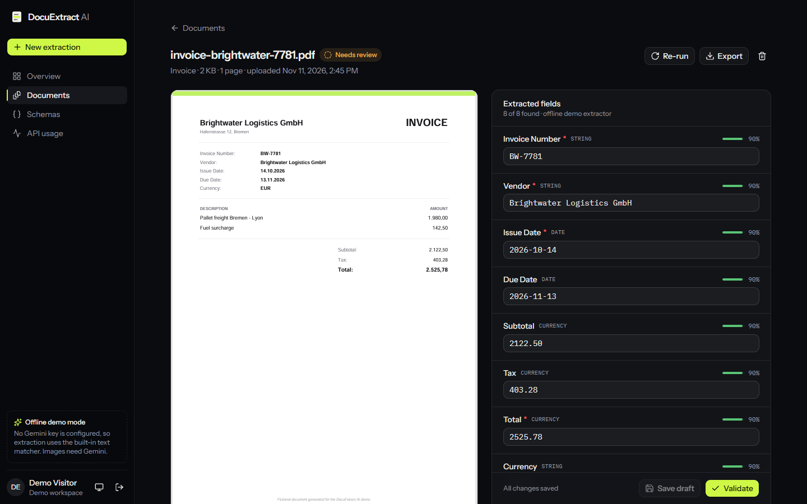
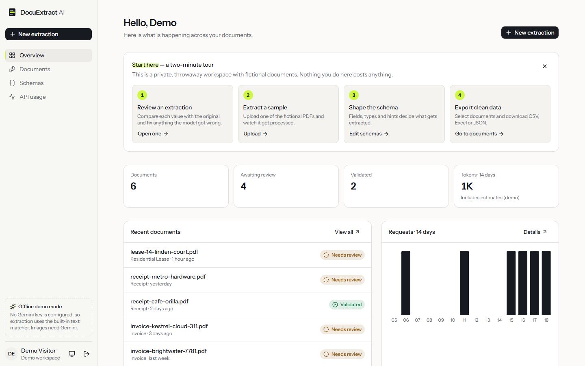
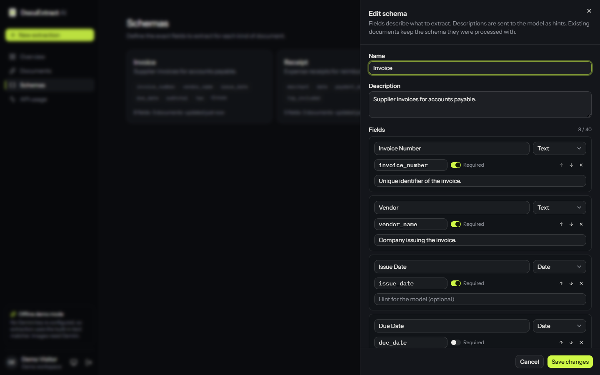
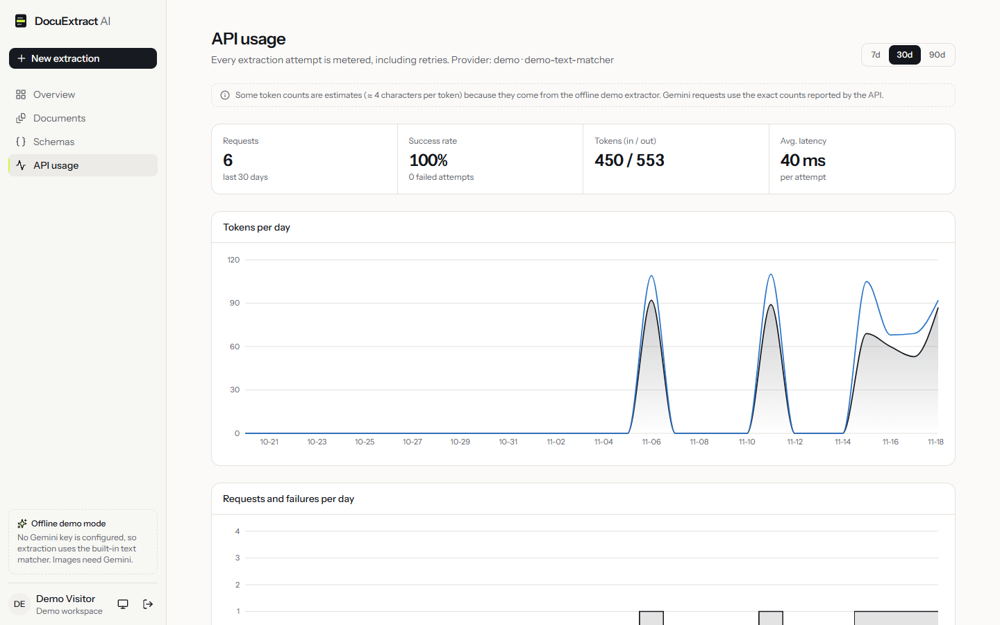
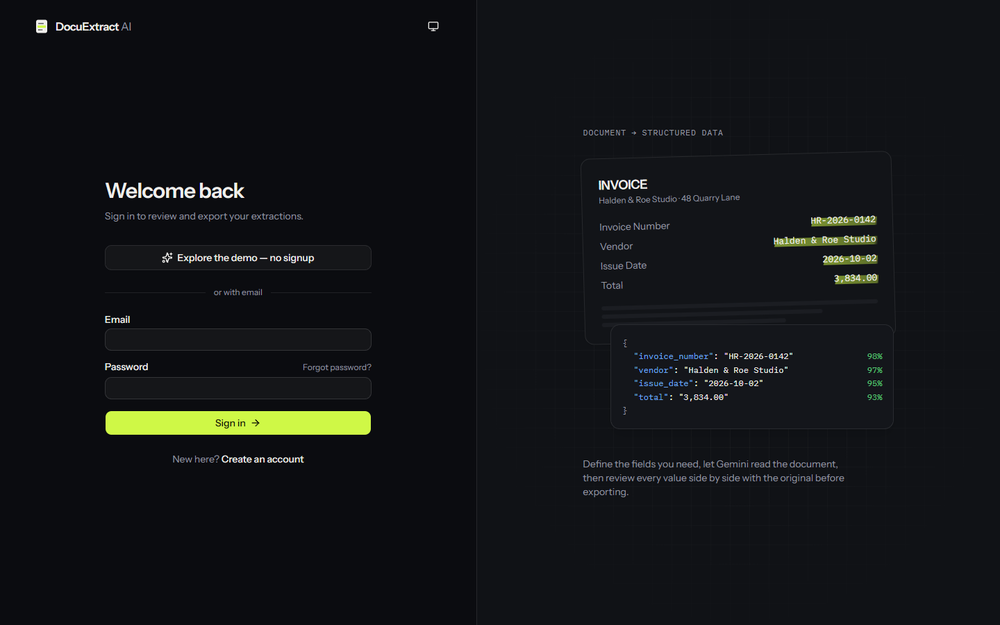
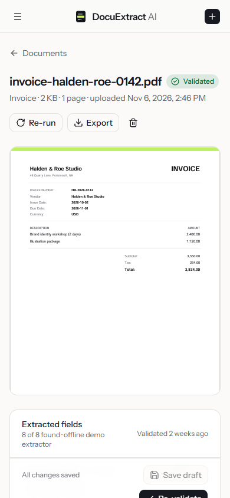
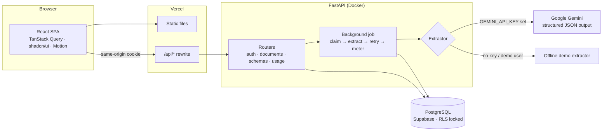
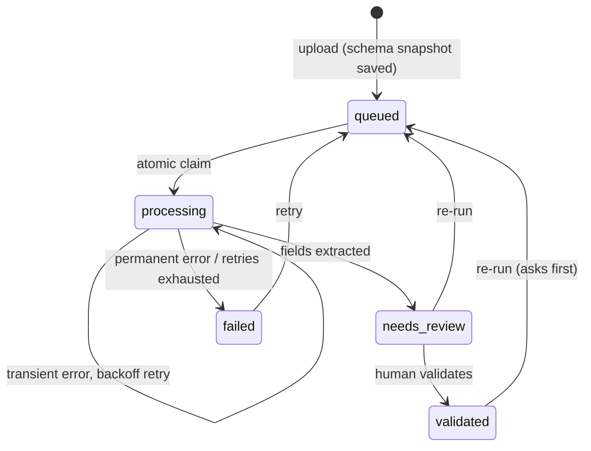

# DocuExtract AI

**Turn PDFs and images into structured, reviewed data.** Define the fields you need, let
Google Gemini read the document, check every value side by side with the original, then
export clean CSV, Excel or JSON.

[](https://github.com/Statzs/docuextract-ai/actions/workflows/ci.yml)


> **About this project.** DocuExtract AI is an independent portfolio project built by
> Rafael Ugarte to show full-stack product engineering end to end. It is a complete,
> working application, but it is not a commercial service: it has no customers or
> production traffic, and every company, person and document in the demo data is fictional.

---

## Try it in 30 seconds

Open the live demo (link added after deployment), or locally go to `/demo`, or click
**Explore the demo — no signup** on the sign-in page. Nothing to install, no account, no key. You get a private, throwaway
workspace with six fictional documents and a short guided tour:

1. open an extraction and compare it with the original,
2. extract one of the sample PDFs yourself (two clicks, no file needed),
3. edit a schema,
4. export the results.

The demo workspace always uses the free offline extractor, so visitors can never spend the
owner's AI budget. Demo workspaces are deleted after 24 hours.

## Highlights

- **Schema-driven extraction.** Users define their own fields (text, number, currency,
  date, yes/no) with optional hints. The schema becomes a JSON response schema for Gemini,
  so the model can only return the requested shape.
- **Human in the loop.** A side-by-side review screen with per-field confidence, inline
  server-side validation, draft saves and an explicit *Validate* step. The raw AI output is
  never overwritten, so there is always an audit trail of what the model said versus what
  the human changed.
- **Reliable processing.** Background jobs with an atomic claim (a job can't run twice),
  exponential-backoff retries for transient provider errors (429/5xx/timeouts), manual
  re-run, and recovery of jobs interrupted by a restart.
- **Cost control.** Every AI attempt, retries included, is metered with tokens, latency
  and outcome. Hard daily caps per user and globally stop a public deployment from running
  up a bill.
- **Runs with zero secrets.** Without a Gemini key the app switches to an offline demo
  extractor, and everything (including the tests) works offline.
- **Security.** HttpOnly cookie sessions, secure password reset that revokes all sessions,
  per-user data isolation (tested for every endpoint), magic-byte file validation,
  formula-injection-safe exports, rate limits that a spoofed IP cannot escape, and RLS
  lock-down of the Supabase Data API.
  Details in [SECURITY.md](SECURITY.md).
- **Accessible.** Every screen passes automated axe WCAG 2.1 AA checks in light and dark
  mode, and animations respect the OS *reduce motion* setting.

| | |
|---|---|
|  |  |
|  |  |
|  |  |

## Architecture





More detail on data flow, the security model and trade-offs:
**[docs/ARCHITECTURE.md](docs/ARCHITECTURE.md)**.

## Tech stack

| Layer | Choice |
|---|---|
| Frontend | React 19, TypeScript, Vite, Tailwind CSS v4, shadcn/ui (Base UI), Motion, TanStack Query, React Router, Recharts |
| Backend | Python 3.12, FastAPI, SQLAlchemy 2, Pydantic v2 |
| AI | Google Gemini via `google-genai` (structured JSON output), default model `gemini-3.5-flash-lite` |
| Database | PostgreSQL on Supabase in production; SQLite locally |
| Testing | pytest (unit + integration), Vitest + Testing Library, Playwright (E2E) + axe-core (accessibility) |
| CI | GitHub Actions: secret scan, lint, type-check, tests on SQLite **and** Postgres, build, E2E |

## Run it locally

Prerequisites: Python 3.12+, [uv](https://docs.astral.sh/uv/), Node.js 22+.

```bash
# 1. API: http://127.0.0.1:8000  (interactive docs at /api/docs)
cd backend
cp .env.example .env          # optional: add GEMINI_API_KEY for real AI extraction
uv sync
uv run uvicorn app.main:app --reload

# 2. Web app: http://localhost:5173  (proxies /api to the API)
cd frontend
npm install
npm run dev
```

Open http://localhost:5173 and click **Explore the demo**, or create an account.

### Demo mode vs. Gemini mode

| | Demo mode (no key) | Gemini mode (`GEMINI_API_KEY` set) |
|---|---|---|
| PDFs with a text layer | Text matcher reads `Label: value` lines | Gemini reads the document |
| Scanned PDFs and images | Fields come back empty, with a notice | Supported |
| Token usage | Estimated (≈ 4 chars/token), marked as such in the UI | Exact counts from the API |
| Cost | None | Billed to your Google AI account, capped by `AI_DAILY_LIMIT_*` |

## Tests

```bash
cd backend  && uv run pytest -q                 # 58 unit + integration tests
cd frontend && npm test                         # 12 unit/component tests
cd frontend && npx playwright install chromium && npm run test:e2e   # 9 E2E + accessibility tests
```

Last local run (2026-11-18): **58/58** backend on SQLite and on PostgreSQL 17,
**12/12** frontend unit, **9/9** Playwright, type-check, lint and production build all
passing.

The backend suite runs against PostgreSQL when `TEST_DATABASE_URL` is set (CI does this).
The E2E suite starts the real API (offline extractor, throwaway database) and the Vite dev
server, then drives Chromium through: sign-up → upload → review → validate → CSV export;
file rejection (including a fake PDF caught by magic bytes); auth redirects; the demo
workspace and guided tour; re-run confirmation; forgot-password; and an axe WCAG 2.1 AA
audit of every screen in light and dark mode.

## Deploy for free

Reference setup: **Supabase** (Postgres) + **Render** (API container, [`render.yaml`](render.yaml))
+ **Vercel** (web app and `/api` proxy). All free tiers, no API key needed: the public demo
runs on the offline extractor. Step-by-step guide with checks and troubleshooting:
**[docs/DEPLOYMENT.md](docs/DEPLOYMENT.md)**.

Two safeguards make a public deployment safe to leave running:
- **Origin lock.** Vercel adds a secret header to every proxied request and the API refuses
  anything without it, so nobody can bypass Vercel to forge client IPs or dodge limits.
- **Cost caps.** If you add a Gemini key, `AI_DAILY_LIMIT_PER_USER` and
  `AI_DAILY_LIMIT_GLOBAL` cap Gemini calls per UTC day, and demo visitors never use Gemini.

All variables are documented in [`backend/.env.example`](backend/.env.example).

## Project structure

```
backend/
  app/
    main.py              FastAPI app, middleware (origin lock), startup recovery
    config.py            typed settings (environment variables)
    models.py            SQLAlchemy models
    schemas.py           Pydantic API contract
    security.py          password hashing, JWT cookie sessions, rate limiting
    routers/             auth (+ password reset), schemas, documents (+ export), usage, samples
    services/            upload validation, processing pipeline, exporters, mailer
    extraction/          provider interface, Gemini adapter, offline extractor, normalisation
    demo/                fictional sample documents + workspace seeding
  migrations/            Alembic migrations (run automatically on startup)
  scripts/               sample PDF generator
  tests/                 pytest unit and integration tests
frontend/
  src/
    lib/                 typed API client, query hooks, formatting
    components/          app shell, upload dialog, demo tour; components/ui = shadcn/ui
    pages/               one file per route
  e2e/                   Playwright specs, accessibility audit, screenshot/video script
docs/
  ARCHITECTURE.md        design, data flow, security model, limitations
  DEPLOYMENT.md          free-tier deployment guide (Supabase + Render + Vercel)
  LEARNING_GUIDE.md      beginner-friendly tour of the technologies and code, with exercises
  INTERVIEW_GUIDE.md     component-by-component walkthrough and likely questions
```

## What has been verified, and what has not

**Verified locally:**
- All automated suites listed above, on SQLite and on PostgreSQL 17 (embedded server).
- Alembic migrations on a real pre-migration database: all rows kept, new column added.
- Real Gemini extraction, run by hand with `gemini-3.5-flash-lite`: a sample invoice PDF
  (8/8 fields correct, including European number formats) and a PNG receipt (5/5). The
  retry path was observed live against real 503/504 responses from the API.
- Supabase-style RLS lock-down: the table owner sees rows, a non-owner role sees none.
- Every screen reviewed by eye in light and dark mode at desktop and phone widths.

**Not verified:** the Docker image build (Docker was not available in the development
environment), the GitHub Actions workflow (it has not run on GitHub yet), a live
Supabase/Render/Vercel deployment (including Vercel's origin-secret header and the
`x-real-ip` value it sends), and password-reset email delivery through a real SMTP server
(the flow is covered by tests with a fake mailer).

## Known limitations

- Jobs run in-process (FastAPI `BackgroundTasks`). Interrupted jobs are marked failed on
  restart and can be retried; a multi-instance deployment needs a durable queue.
- Rate limiting is in memory and per instance; several API instances would need a shared
  store such as Redis.
- Sessions are stateless JWTs. A password reset revokes all of a user's sessions, but
  logout only clears the cookie on that device.
- Files are stored in Postgres (`bytea`, 10 MB cap). Object storage with signed URLs is the
  scaling path.
- Extraction fields are flat (no repeating line-item tables yet).
- The offline demo extractor is a simple text matcher, not AI, and cannot read images.
- No email verification on sign-up. Password reset needs SMTP in production; without it
  the "Forgot password?" link is hidden.

## License

[MIT](LICENSE) © 2026 Rafael Ugarte
