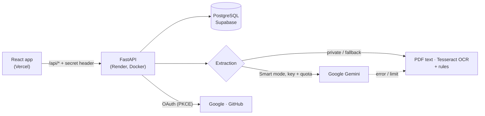
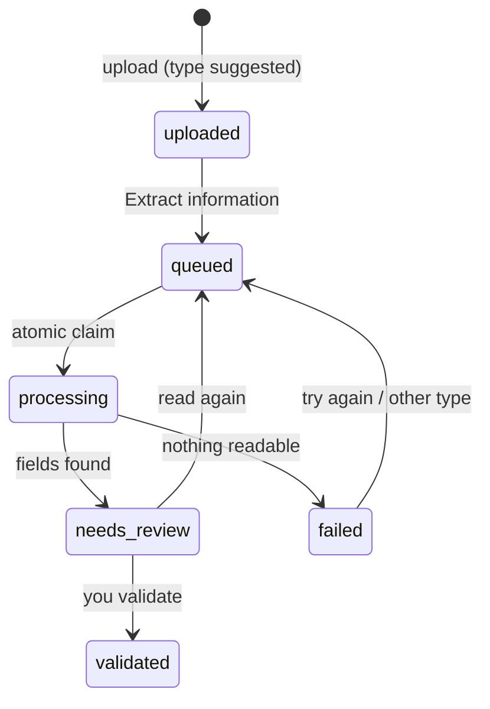

# DocuExtract AI

**Turn invoices, receipts and contracts into a spreadsheet.** Upload a PDF or a photo,
say what kind of document it is, and DocuExtract finds the dates, names, totals and
reference numbers. You check them next to the original and download Excel, CSV or JSON.

[](https://github.com/Statzs/docuextract-ai/actions/workflows/ci.yml)


> **About this project.** DocuExtract AI is an independent portfolio project built by
> Rafael Ugarte to show full-stack product engineering end to end. It is a complete,
> working application, but not a commercial service: it has no customers, and every
> company, person and document in the demo data is fictional.

---

## Try it

**[docuextract-ai-three.vercel.app](https://docuextract-ai-three.vercel.app)** — works on
a phone, tablet or computer. Click **Try it now — no signup** for a private, throwaway
workspace with fictional documents (deleted after 24 hours), or create a free account with
Google, GitHub or an email.

The server runs on a free plan that sleeps when nobody uses it. The first visit after a
quiet period can take up to a minute; the page says so while it wakes up.

## How to use it (four steps)

1. **Upload** a PDF, PNG, JPEG or WebP (up to 10 MB).
2. **Choose the type**: Invoice, Receipt, Contract, Purchase Order, Payment Record or
   General Document. When the text makes it obvious, the type is already selected for you
   (marked *Suggested*). Need other fields? Make your own template under *Advanced →
   Templates*.
3. Click **Extract information**. You can pick **Smart (AI)** or **Private (no AI)**.
4. **Check and download.** Each value sits next to the document with a confidence score.
   Fix anything wrong, click *Validate*, then *Download* as Excel, CSV or JSON — one
   document or all of them.

## How the reading works

DocuExtract combines AI with classic methods, and always tells you which one was used
(a badge on every document: *Read by AI*, *Text reading* or *OCR*).

| Method | When | How |
|---|---|---|
| **Smart (AI)** | Default, when the server has a Gemini key and quota left | Google Gemini (`gemini-3.5-flash-lite`) reads the file and must answer in the exact shape of the template. |
| **Text reading** | Private mode, or as the fallback for PDFs | Reads the PDF's own text layer and matches labels (`Total`, `Invoice No.`, `Fecha`…) with rules. |
| **OCR** | Private mode or fallback, for photos and scanned PDFs | Tesseract (English + Spanish) turns the image into text, then the same rules apply. |

**Never invented.** If a value is not in the document, the field stays empty. AI answers
are cross-checked against the PDF's text: a value the AI returns that cannot be found in
the document gets a low confidence and a "please check" note. Dates and amounts are
normalised (`02 Oct 2026` → `2026-10-02`, `1.234,50` → `1234.50`).

### What happens without Gemini

Nothing breaks. If there is no key, the key is wrong, Google is down, or the daily AI limit
is reached, the document is read with text reading or OCR instead, and a note explains why
(for example *"Today's AI limit is reached, so standard text reading was used."*). The
demo workspace always uses the free methods, so visitors can never spend the AI quota.

### Privacy

On Google's free tier, Gemini may use what it receives to improve Google's products. So:
the AI option says so before you use it, and **Private (no AI)** reads the document entirely
on DocuExtract's own server. Use Private mode for anything confidential. Documents are
deleted automatically after 30 days (configurable), and you can delete a document or your
whole account at any time.

### Accuracy (measured, fictional documents)

`backend/scripts/benchmark.py` generates fictional invoices, receipts, purchase orders and
payment records in several layouts and scores every field. Some layouts use wordings the
rules have never seen ("Bill No.", "Sold by", "Amount payable"), so the score is not
tuned to the test.

CI run of 2026-11-18, 20 documents per layout, 95 fields each:

| Layout | Method | Fields correct |
|---|---|---|
| `Label: value` lines | Text reading + rules | 91/95 (96 %) |
| Two-column tables | Text reading + rules | 91/95 (96 %) |
| Label above value | Text reading + rules | 87/95 (92 %) |
| Rotated, blurred, noisy scan | Tesseract OCR + rules | 90/95 (95 %) |

Run `uv run python -m scripts.benchmark --gemini` with a key to compare against the AI.
These are synthetic documents: real-world documents are messier, which is why every
value is shown for review.

## For the owner: administration

Sign in once with Google or GitHub using an email listed in `ADMIN_EMAILS`. An **Admin
panel** link appears (nobody else can open it; the page answers "not found"). It shows:

- Gemini status (key set, model, last success, last error) and a *Check the key now* button.
- Whether the fallbacks work (PDF text, OCR languages).
- Today's AI extractions vs. the limit, documents, failures, average processing time, users.
- **Limits you can change live**: AI on/off, AI extractions per user and in total per day,
  uploads per user per day, pages per PDF, OCR pages, days before documents are deleted.

## Show it in an interview (3 minutes)

1. Open the landing page on your phone: explain the problem in one sentence.
2. **Try it now** → open a checked invoice: values next to the PDF, confidence, method badge.
3. Open the scanned photo, choose *Receipt*, *Extract information*: OCR reads it live.
4. Upload the purchase-order sample: the type is suggested, one click to extract.
5. *Download* → Excel.
6. Say what happens without AI (the fallback) and why there is a Private mode.

The full walkthrough and likely questions are in **[docs/INTERVIEW_GUIDE.md](docs/INTERVIEW_GUIDE.md)**.

## Highlights for engineers

- **Hybrid pipeline with honest provenance.** AI → fallback to PDF text or OCR + rules,
  with the method and the reason stored per document. Retries with backoff for 429/5xx.
- **Cost and abuse control.** Per-user and global daily AI caps, upload caps, page and
  size limits, duplicate-file detection (same file → same document, no second AI call),
  signup honeypot, rate limits keyed on an IP a client cannot spoof.
- **Secure sign-in.** Google and GitHub OAuth with PKCE and a signed state cookie;
  accounts are linked only by a provider-verified email, and a pre-registered unverified
  account cannot take over the OAuth user.
- **Safety.** Per-user isolation tested on every endpoint, magic-byte file checks,
  decompression-bomb guard for images, prompt-injection instruction for the AI,
  formula-safe exports, retention purge, account deletion. See [SECURITY.md](SECURITY.md).
- **Accessible and responsive.** axe WCAG 2.1 AA checks on every screen in light and dark
  mode; phone layouts; reduced-motion support.

## Architecture





More detail: **[docs/ARCHITECTURE.md](docs/ARCHITECTURE.md)**.

## Tech stack

| Layer | Choice |
|---|---|
| Frontend | React 19, TypeScript, Vite, Tailwind CSS v4, shadcn/ui (Base UI), Motion, TanStack Query, React Router |
| Backend | Python 3.12, FastAPI, SQLAlchemy 2, Pydantic v2, Alembic |
| Reading | Google Gemini (`google-genai`), pypdf, pypdfium2, Tesseract (`pytesseract`), Pillow |
| Database | PostgreSQL on Supabase; SQLite locally |
| Testing | pytest, Vitest + Testing Library, Playwright + axe-core |
| CI | GitHub Actions: secret scan, lint, type-check, tests on SQLite and Postgres, accuracy benchmark, build, E2E |

## Run it locally

Prerequisites: Python 3.12+, [uv](https://docs.astral.sh/uv/), Node.js 22+. Optional:
[Tesseract](https://tesseract-ocr.github.io/tessdoc/Installation.html) for reading photos.

```bash
# 1. API on http://127.0.0.1:8000
cd backend
cp .env.example .env          # optional: add GEMINI_API_KEY
uv sync
uv run uvicorn app.main:app --reload

# 2. Web app on http://localhost:5173
cd frontend
npm install
npm run dev
```

## Tests

```bash
cd backend  && uv run pytest -q                       # 88 unit + integration tests
cd backend  && uv run python -m scripts.benchmark     # accuracy on generated documents
cd frontend && npm test                               # 12 unit/component tests
cd frontend && npx playwright install chromium && npm run test:e2e   # 11 E2E + accessibility
```

Last local run (2026-11-18): backend 87 passed, 1 skipped (the OCR test, because
Tesseract is not installed on that machine; CI installs it), frontend 12/12, Playwright
11/11, type-check, lint and build passing.

## Deploy for free

Supabase (database) + Render (API, [`render.yaml`](render.yaml)) + Vercel (web app and
`/api` proxy), all on free plans. Step by step, including how to create the Gemini key and
the Google/GitHub sign-in apps: **[docs/DEPLOYMENT.md](docs/DEPLOYMENT.md)**. Every
setting is listed in [`backend/.env.example`](backend/.env.example).

## Project structure

```
backend/app/
  routers/       auth, oauth, documents (+ export), templates, usage, admin
  services/      upload checks, processing pipeline, limits, exporters, mailer
  extraction/    Gemini adapter, PDF text + OCR, rules, type suggestion, grounding check
  demo/          fictional sample documents + demo workspace seeding
backend/scripts/ sample generator, accuracy benchmark
frontend/src/
  pages/         landing, auth, dashboard, documents, document detail, templates, usage, admin
  components/    app shell, upload dialog, type/mode choosers, demo tour, ui/ (shadcn)
docs/            ARCHITECTURE, DEPLOYMENT, INTERVIEW_GUIDE, LEARNING_GUIDE
```

## Known limitations

- **OCR is slow on the free server** (shared 0.1 CPU): a photo can take several seconds
  and only the first pages of a scanned PDF are read (`OCR_MAX_PAGES`).
- Rules read flat fields; repeating line-item tables are not extracted.
- Gemini's free tier has small daily quotas (Google can change them); over the limit,
  documents are read without AI.
- Jobs run inside the API process. A restart marks running jobs failed (retry is one click).
- Rate limits are in memory, per instance.
- Files are stored in Postgres (10 MB cap); object storage is the scaling path.
- Sessions are stateless JWTs; logout clears the cookie on that device only.
- Password reset needs an SMTP server in production; without it the link is hidden.

## License

[MIT](LICENSE) © 2026 Rafael Ugarte
